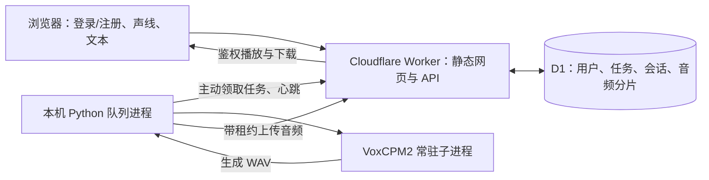

# 神都声馆 · Shendu Voice Station

一个带声线库、排队生成和管理后台的语音克隆网站。用户选择声线、输入文字，生成设备用参考录音合成新的语音；每个人只能访问自己的生成记录。

**在线站点：[voice.shendu.whk.me](https://voice.shendu.whk.me/)** · **模型：[OpenBMB/VoxCPM](https://github.com/OpenBMB/VoxCPM)** · **权重：[VoxCPM2](https://huggingface.co/openbmb/VoxCPM2)**

本仓库公开网站、云端 API、队列、生成进程、加载适配器及测试代码。游戏录音、游戏头像、模型权重、生产账号、密钥和数据库不在仓库中；独立部署需要准备自己有权使用的参考音频。空头像映射会自动显示文字头像。

## 用了什么模型？

当前在线推理模型是 **VoxCPM2**。早期做过 VoxCPM2、IndexTTS-2.5、LongCat-AudioDiT-3.5B、OmniVoice 的对比，最终选择 VoxCPM2 建设这个网站。这个仓库的线上生成链路只接入 VoxCPM2，不包含另外三个模型的运行器，也不提供网页切换模型。

这里采用预训练模型的参考音频克隆：为每个声线准备一段完整、清晰的参考语音和与之对应的文字，再把用户输入交给模型。没有为每个角色重新训练模型或训练独立 LoRA。参考样本、文字对应关系和录音中的背景音乐都会影响效果，结果不能保证与原配音完全一致。

当前实现沿用已验证的本机 CPU 路径：

- Python 生成进程常驻一份模型，父进程管理任务，子进程运行模型。
- CPU 语言模型使用 BF16，AudioVAE 使用 FP32；每段推理 10 步。
- `voxcpm_low_memory_adapter.py` 用 meta 初始化和逐张量装载减少加载峰值，重建非持久化 RoPE 缓冲区；它依赖上游内部类接口，升级 VoxCPM 后需要重新验证。
- 权重可复制到常驻内存，减少外部磁盘 mmap 反复读取。没有修改训练权重数值或另行量化。
- 文本按标点分句，长句不超过 60 字；生成 PCM16 WAV，句间加入约 0.24 秒停顿。
- 当前 runner 固定 CPU，不是开箱即用的 CUDA 部署包。适配器包含 MPS 分支，但线上 runner 没有使用它。

## 整个系统如何工作



### 1. 网页和账号

前端使用原生 HTML、CSS、JavaScript，不依赖前端框架。Worker 同时提供静态资源和 API。支持用户名、密码注册并自动登录，不要求验证码；注册只创建普通用户。后台有基础的注册、登录频率限制。

密码采用随机盐及 PBKDF2-HMAC-SHA256（100000 次）存储；会话使用 HttpOnly、Secure、SameSite Cookie。写操作检查同源和 CSRF。管理员能管理用户、显示或隐藏声线、调整字数及每人待处理上限、查看任务状态和审计日志。

源码公开不意味着用户生成的台词和作品公开。用户接口按账号检查任务所有权；管理任务列表不展示他人的台词和音频地址。

### 2. 排队和本机生成

提交时生成幂等请求标识，避免重试造成重复任务。D1 按任务 ID 顺序排队，通过原子领取和唯一运行位确保一次只生成一条。默认每人最多 3 条排队或运行任务，管理员可设 1～10 条。

生成设备主动通过 HTTPS 连接 Worker，因此不需要给家里的 Mac 开放公网端口。云端使用租约标识区分不同生成尝试，过期或已取消尝试不能正常完成当前任务。设备掉线后队列仍然存在；恢复后继续按顺序处理。当前设计针对单台生成设备，不是多 GPU 调度系统。

父子进程通过 JSON 行消息传递任务与进度。网页显示加载、生成、上传阶段、已完成句数和用时；这是分句进度，不是模型 token 级百分比。默认模型加载超过 5 分钟、单句 10 分钟没有进展会触发看门狗：先停掉旧进程，再重试一次，仍失败就结束该任务并继续队列。网络错误在有效租约内按 5/10/20 秒退避，保留已完成音频供上传重试。

### 3. 音频存储和回收

当前部署使用 D1 存放音频：每片 128 KiB，先预留容量、写入分片，检查完整后再发布音频索引。播放支持 Range 读取。相同音频的上传重试复用版本；未完整上传的文件不会作为完成作品公开。

默认总音频额度 **400 MiB**，单个生成文件最多 25 MiB；这是应用配置，不是模型限制。参考音频与作品共用额度。70% 提醒、85% 警告、95% 停止接单；另外为每个已接受任务按最大文件容量预留空间，可能提前停止接单。

删除作品先进入 7 天回收站，期内可恢复记录；取消的任务不会因恢复记录重新执行。每天北京时间 03:00 清理符合条件的过期分片，每批最多 20 个版本，也可在后台预览后回收。原声、在途任务、仍有效的作品和恢复期内音频受保护，来源不明的历史孤立样本不会自动删除。本机调试 WAV 不随云端回收自动删除。

代码保留私有 R2 存储适配入口，但本项目的存储预警和回收功能当前针对 D1。切换 R2 需要迁移既有音频并补齐生命周期管理，不能仅更改绑定后假定旧音频仍可访问。

### 4. 历史记录

在途任务独立展示，不会被历史分页挤掉。历史每页 20 条，支持状态筛选及**角色名字搜索**，输入部分名字即可，搜索覆盖服务端全部历史。提交期间继续编辑的草稿不会被成功响应清空，后台连续操作会排队执行，未保存设置不会被其他操作的刷新覆盖。

## 目录

```text
ui/                         网页与管理后台
cloud/worker.js             Cloudflare API、账号、排队、管理、回收
cloud/d1_audio.js           D1 音频分片与 Range 读取
cloud/schema.sql           新数据库的完整结构
cloud/migrations/          旧数据库的增量迁移
worker.py                   本机队列、租约、看门狗、上传
voxcpm_runner.py            模型子进程、分句、WAV 输出
voxcpm_low_memory_adapter.py 模型加载适配器
store.py / server.py        早期本地 SQLite / HTTP 实现
examples/                   不含凭据的配置和声线 SQL 示例
test_*.py / test_ui.mjs      运行端和前端回归检查
cloud/test_worker.mjs        云端 API 与实际 SQLite SQL 检查
```

`server.py` 是本地原型，尚未同步全部云端注册、管理、搜索和回收功能。完整网站请使用 Cloudflare Worker，不要把原型作为功能等价的生产服务。

## 自行部署

生成运行端使用 `fcntl`，支持 macOS/Linux；原生 Windows 需另做进程锁适配。测试还需要在所选 Python 环境中安装 `pytest`。

需要 Cloudflare 账号、Node.js（测试使用内置 `node:sqlite`，建议 Node 22.13+）、Python 3.12，以及能运行 VoxCPM2 的机器。参考音频和模型权重需自行准备。下面命令用于新部署，不会连接示例站点。

### A. 部署网页和数据库

```sh
cd cloud
npm install
npx wrangler login
npx wrangler d1 create shendu-voice-station
```

把返回的数据库 ID 填入 `cloud/wrangler.jsonc`；示例中的全零 ID 是占位符。新数据库使用完整结构：

```sh
npx wrangler d1 execute shendu-voice-station --remote --file schema.sql
npx wrangler secret put WORKER_TOKEN
npx wrangler deploy
```

`WORKER_TOKEN` 请自行生成足够长的随机值，通过提示输入并保存在生成设备的私有配置中，二者保持一致。不要把真实配置提交到仓库。自定义域名按 Cloudflare 的配置流程绑定；模板不含生产数据库 ID 或域名路由。

**新库初始化与旧库迁移是两条不同路径。** 使用最新 `schema.sql` 建库后，不要再把 `0001`、`0002` 的 `ALTER TABLE` 迁移重复应用；这些文件供已有旧结构数据库升级时使用。既有数据库先备份并确认已应用版本，再用 Wrangler migrations 命令升级。

### B. 创建管理员

打开你自己的部署地址，用注册功能创建账号，再在自己的数据库将该账号提升为管理员：

```sh
npx wrangler d1 execute shendu-voice-station --remote \
  --command "UPDATE users SET role='admin' WHERE username='your_admin_account';"
```

重新登录后访问 `/admin`。没有预设管理员密码，公开仓库也不包含示例站点的账号。

### C. 准备声线

参考 `examples/voice.sql`：先插入声线名称、参考录音对应文字、长度、存储键，保持 `available=0`。使用服务令牌调用 `PUT /api/worker/voices/:id/reference` 上传 WAV（最大 2 MiB），核对返回的 SHA-256 与本地一致，再将 `available` 改为 `1`。接口详见 [cloud/API.md](cloud/API.md)。请提供完整且清晰的句子，而不是把字音片段随意拼接。

头像可由自己的图片生成；`ui/portraits.json` 的格式为 `{"portraits":{"voice-id":"/portraits/<16至64位十六进制文件名>.webp"}}`。把对应文件放入 `ui/portraits/` 再部署；没有头像也可使用。

### D. 启动生成设备

按 [VoxCPM 上游说明](https://github.com/OpenBMB/VoxCPM) 获取源码、依赖及 VoxCPM2 权重。加载适配器使用上游内部接口，建议保存并锁定你验证过的上游 revision；本仓库不承诺任意后续版本兼容。

复制 `examples/worker-config.example.json` 到仓库外的私有目录，将所有路径改为绝对路径，填写自己的 Worker URL 和服务令牌。`runtime_paths` 通常留空，使用安装好依赖的 Python 环境；只有自行分层管理依赖时才需要额外路径。

```sh
/path/to/your/venv/bin/python -u worker.py --config /private/path/worker-config.json
```

首次输出 `MODEL_READY` 表示加载完成。请只启动一份服务，保持设备在线。本机采用文件锁防止重复模型进程。macOS 可以用 LaunchAgent 做登录后自动启动和异常重启，Linux 可用服务管理器；本仓库不会自动安装或修改系统服务。

## 测试

```sh
node cloud/test_worker.mjs
node test_ui.mjs
/path/to/your/venv/bin/python -m pytest -q test_store.py test_server.py test_worker.py
```

云端测试用 Node 内置 SQLite 和内存存储模拟 Worker 绑定，验证实际 SQL、FIFO、并发领取、账号隔离、注册、CSRF、幂等、租约、分页、存储分片和回收。Python 测试包括真实子进程的超时终止与重试；UI 测试用轻量 DOM 模拟验证异步行为。它们不替代 Cloudflare 平台验收或真人听感评估。

## 适用范围和素材

本项目从少量用户共享一台生成设备的需求出发。注册不含验证码、邮箱验证或找回密码；忘记密码可由管理员重置。模型加载和生成速度受机器与文本长度影响，不保证实时合成；长文本仍限制在最多 300 字。

项目代码、上游模型和游戏素材是不同的内容。VoxCPM 的许可与使用条件请查看其上游仓库和模型卡；本仓库不分发游戏音频、头像或模型权重，也不代表游戏官方。请使用自己有权使用的录音，并明确标识合成音频。
